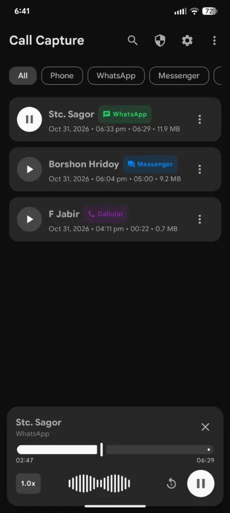
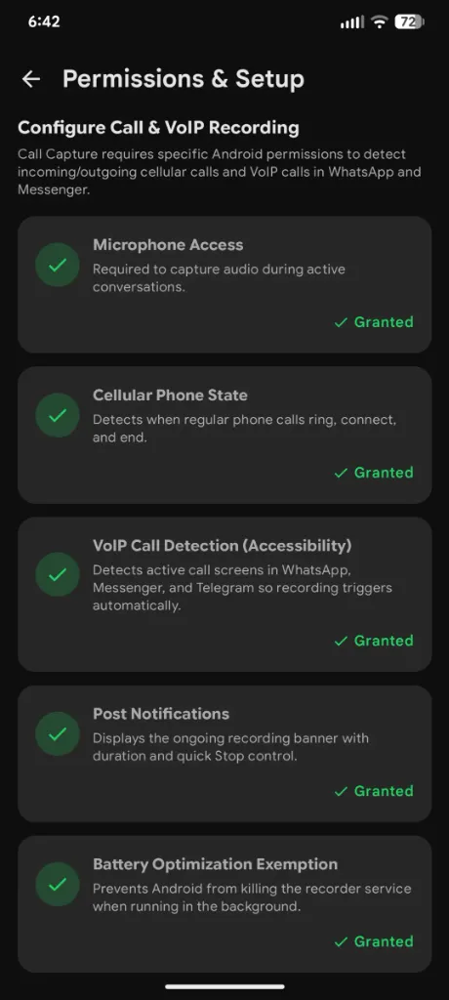
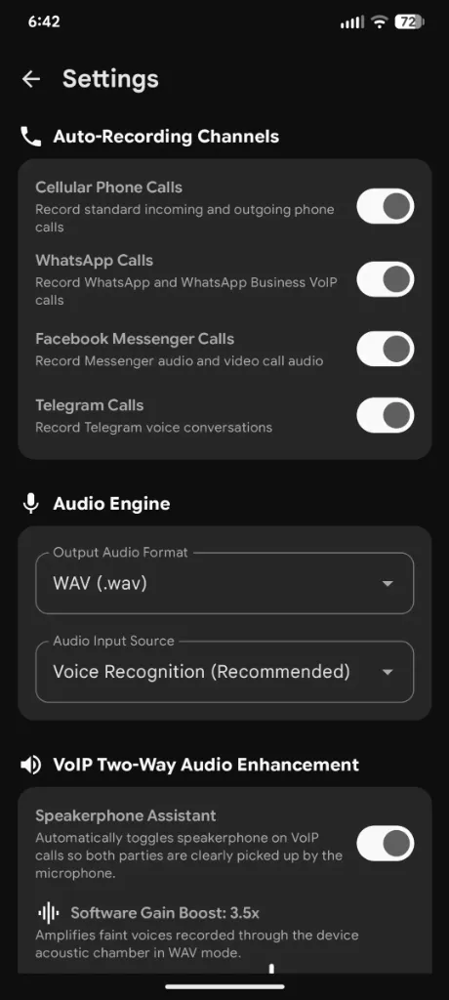

# Call Capture 🎙️
### Universal Call & VoIP Recorder for Android

**Call Capture** is a modern, privacy-focused Android application designed to automatically detect and record:
- 📞 **Cellular Phone Calls** (Incoming & Outgoing via `TelephonyManager`)
- 💬 **WhatsApp & WhatsApp Business Calls** (VoIP via `AccessibilityService` & `NotificationListener`)
- 💬 **Facebook Messenger Calls** (Audio & Video calls via VoIP detection)
- ✈️ **Telegram Voice Calls**
- 🛡️ Other supported VoIP calling applications

Built with **Jetpack Compose**, **Material 3**, **Kotlin Coroutines**, **Room Database**, and **Android Foreground Service (`microphone`)** architecture compliant with Android 8.0 through Android 15 (API 35+).

---

## 📸 Screenshots

| Home & Audio Player | Permissions & Setup | Settings & Audio Engine |
|:---:|:---:|:---:|
|  |  |  |

---

## 🏗️ Architecture & How It Works

```
┌────────────────────────────────────────────────────────────────────────┐
│                          Call Event Detection                          │
├───────────────────────────────────┬────────────────────────────────────┤
│       Cellular Phone Calls        │            VoIP Calls              │
│  (TelephonyManager & Receiver)    │ (Accessibility + Notification Svc) │
│ • EXTRA_STATE_RINGING             │ • Detects WhatsApp, Messenger, etc.│
│ • EXTRA_STATE_OFFHOOK             │ • Parses call active windows       │
│ • EXTRA_STATE_IDLE                │ • Extracts caller/contact names    │
└─────────────────┬─────────────────┴──────────────────┬─────────────────┘
                  │                                    │
                  ▼                                    ▼
┌────────────────────────────────────────────────────────────────────────┐
│             Foreground Service (type: microphone)                      │
│ • Shows persistent notification with elapsed time & Stop button        │
│ • Speakerphone Assistant: auto-toggles speakerphone for VoIP clarity   │
├────────────────────────────────────────────────────────────────────────┤
│                       Audio Capture Pipeline                           │
│ • AAC Engine (MPEG-4/AAC 128kbps)                                      │
│ • WAV PCM Engine with Digital Gain Amplification (1.0x - 5.0x)         │
└──────────────────────────────────┬─────────────────────────────────────┘
                                   │
                                   ▼
┌────────────────────────────────────────────────────────────────────────┐
│                  Storage & Presentation Layer                          │
│ • Local Room Database (Recordings, Metadata, Starred, Notes)           │
│ • Jetpack Compose UI (Search, Filter Chips, Waveform Visualizer)       │
│ • Multi-Select Batch Operations (Select All, Batch Delete, Batch Share)│
│ • In-app Audio Player with 1.0x / 1.5x / 2.0x speed & seekbar          │
│ • FileProvider integration for instant sharing / export                │
└────────────────────────────────────────────────────────────────────────┘
```

1. **Cellular Phone Call Detector (`PhoneCallReceiver`)**:
   - Listens to system telephony broadcasts (`PHONE_STATE` and `NEW_OUTGOING_CALL`).
   - Automatically begins recording when the call connects (`OFFHOOK`) and finalizes when the call ends (`IDLE`).
   - Resolves the caller's contact name via Android `ContactsContract` and late call-log queries.

2. **VoIP Detection Engine (`VoipAccessibilityService`)**:
   - Continuously monitors foreground window state changes for supported VoIP package names (`com.whatsapp`, `com.facebook.orca`, `org.telegram.messenger`, etc.).
   - Parses the accessibility node tree to identify call controls and caller information.
   - Automatically extracts the remote participant's name and triggers `CallRecordingService`.
   - Incorporates a debounce mechanism to avoid interrupting recordings during quick screen rotations or temporary app-switching.

3. **VoIP Notification Listener (`VoipNotificationListenerService`)**:
   - Serves as a complementary fallback by observing incoming and ongoing call notifications (`CATEGORY_CALL`).

4. **Speakerphone Assistant & Software Gain Booster**:
   - On non-rooted Android devices, internal VoIP audio cannot be intercepted directly from other apps' private memory space.
   - Call Capture includes an optional **Speakerphone Assistant**: when a WhatsApp or Messenger call starts, it activates speakerphone mode so the device's high-fidelity microphone clearly captures both your voice and the incoming remote voice.
   - In WAV mode, the **Software Gain Booster** amplifies recorded audio levels with digital gain to produce clean, audible recordings.

---

## 📱 Key Features

- **Automatic Multi-Platform Recording**: Record Cellular, WhatsApp, Messenger, and Telegram automatically.
- **Multi-Select & Batch Management**: Long-press any item to activate selection mode, Select All, batch delete with confirmation, and batch share.
- **In-App Audio Player**:
  - Interactive playback bar with seekbar and timestamps.
  - Variable playback speed (`1.0x`, `1.5x`, `2.0x`).
  - Quick 5-second replay button.
  - Animated live audio waveform visualization.
- **Organization & Search**:
  - Filter by tabs: **All**, **Phone**, **WhatsApp**, **Messenger**, **Telegram**, **Starred**.
  - Instant search across contact names, phone numbers, and notes.
- **Metadata & Notes**:
  - Add and edit notes for any recording.
  - View call direction, exact duration, file size, and timestamp.
- **Secure File Sharing**:
  - Share recordings to Google Drive, Email, or other apps using Android `FileProvider`.

---

## 🛠️ Required Android Permissions

| Permission | Purpose |
|------------|---------|
| `RECORD_AUDIO` | To record sound during telephone and VoIP calls |
| `READ_PHONE_STATE` / `READ_CALL_LOG` | To detect incoming/outgoing cellular calls and phone numbers |
| `READ_CONTACTS` | To resolve phone numbers into saved contact names |
| `FOREGROUND_SERVICE_MICROPHONE` | Android 14/15/16 declaration for background recording service |
| `POST_NOTIFICATIONS` | Ongoing notification banner with timer and Stop control |
| `Accessibility Service` | Detects active call screens and caller info in WhatsApp, Messenger, and Telegram |
| `Ignore Battery Optimization` | Prevents the operating system from terminating the background recorder |

---

## 🚀 Building & Running

### Requirements
- **Android Studio Ladybug (2024.2+)** or later
- **JDK 17 or JDK 21**
- **Android SDK Platform 35 (Android 15)**
- Minimum supported SDK: **API 24 (Android 7.0)**

### Build via Command Line
```bash
# Build Debug APK
./gradlew assembleDebug

# Build Release APK
./gradlew assembleRelease
```

---

## ⚙️ Initial Device Setup Checklist

1. Open **Call Capture**.
2. Tap the **Shield / Permissions** icon in the top app bar.
3. Grant **Microphone Access** and **Phone State / Call Log**.
4. Tap **Enable in Settings** under **VoIP Call Detection (Accessibility)**:
   - Go to **Installed apps / Accessibility**.
   - Select **Call Capture VoIP Call Assistant** and toggle it **ON**.
5. (Optional) Disable Battery Optimization for Call Capture to guarantee 100% background reliability.
